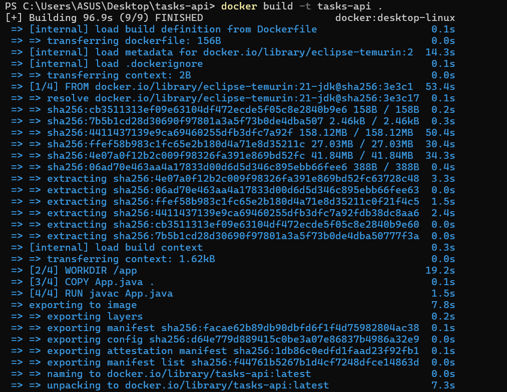
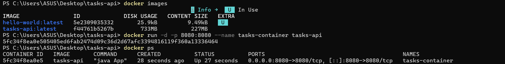
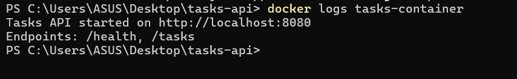
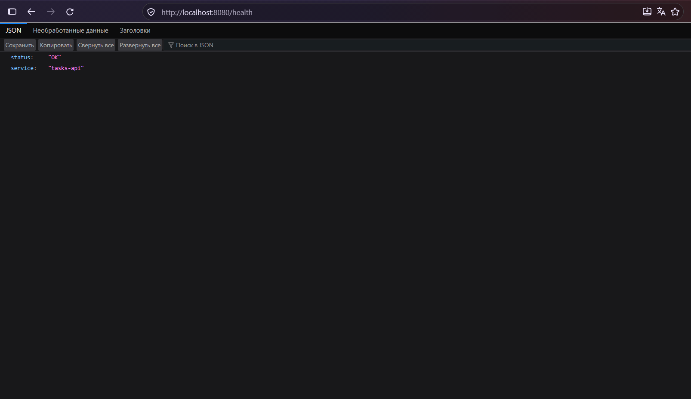
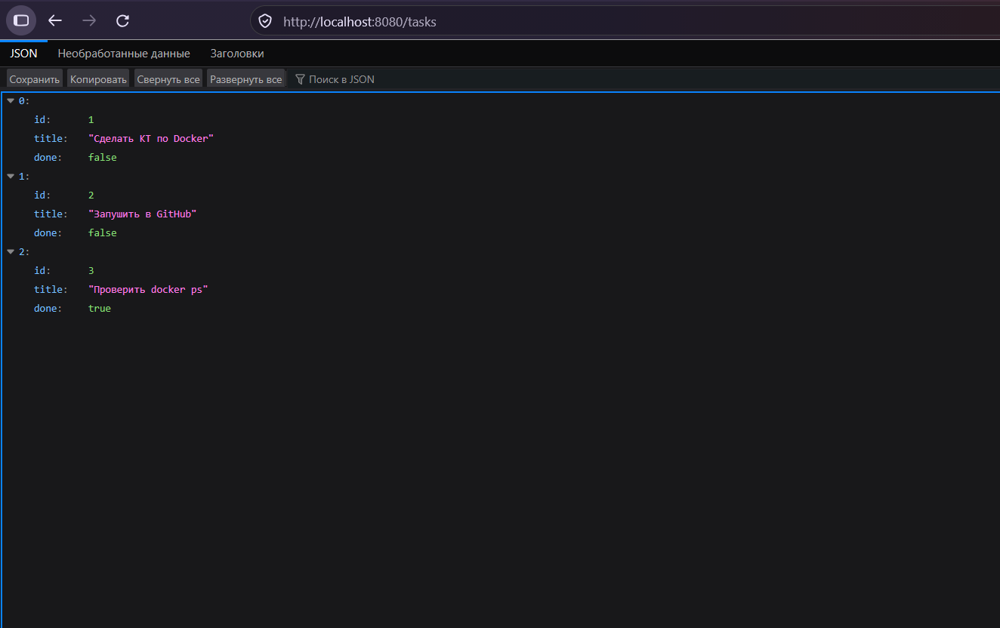
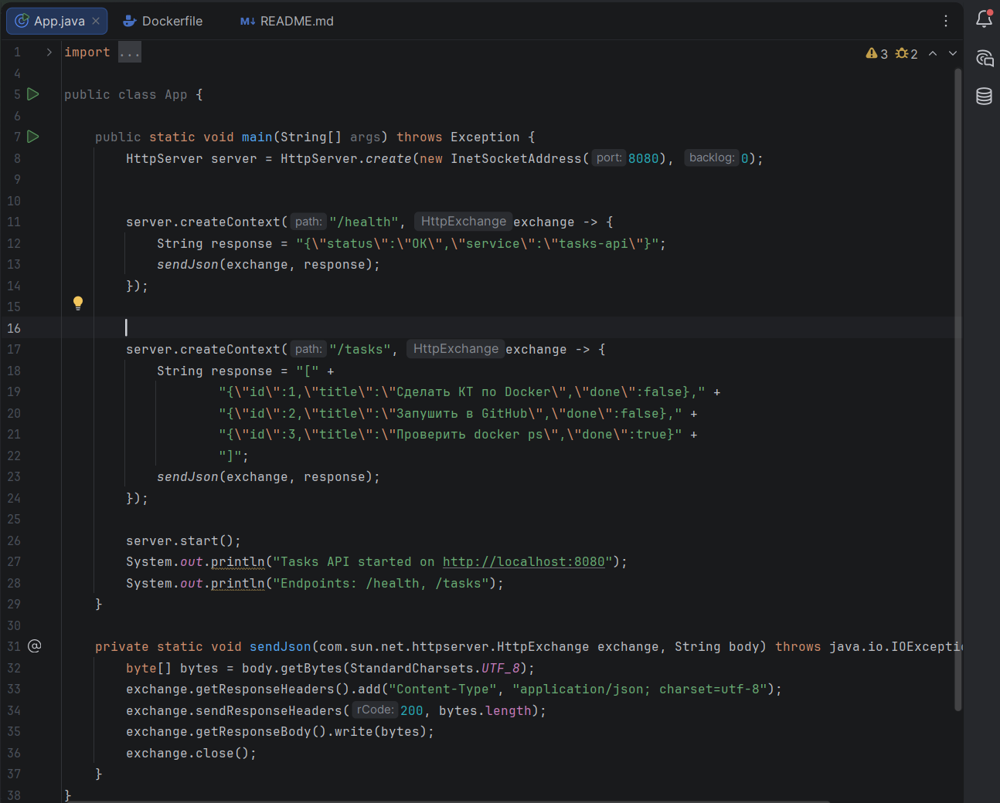
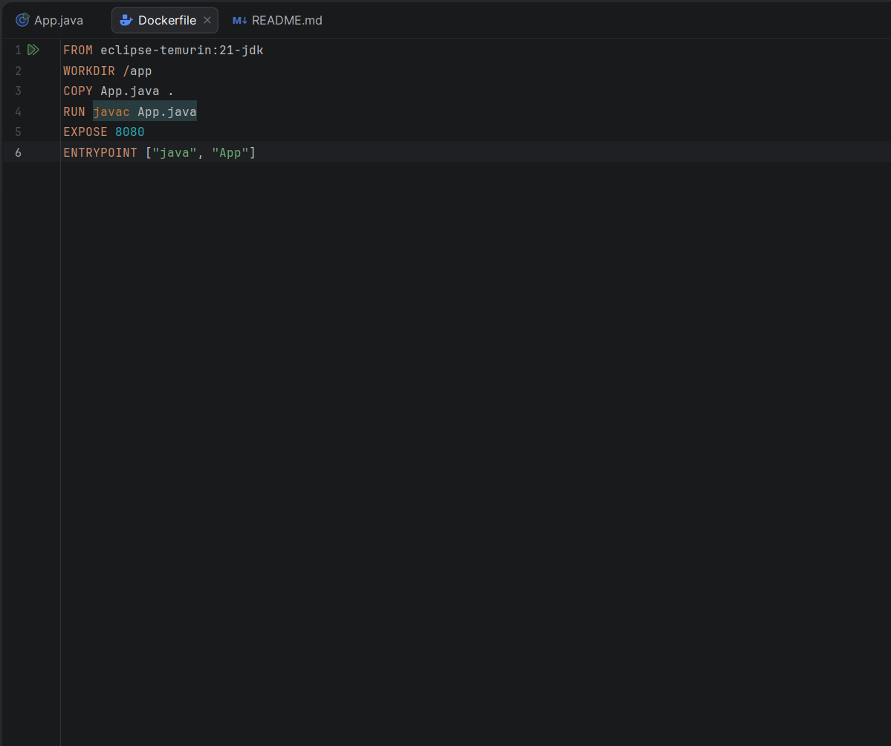

# Tasks API

REST API для сервиса задач на Java. Упаковано в Docker-контейнер.

## Тема проекта

**Сервис задач**

## Endpoints

| Метод | Путь      | Описание                   |
| ----- | --------- | -------------------------- |
| `GET` | `/health` | Проверка работоспособности |
| `GET` | `/tasks`  | Список задач               |

## Запуск в Docker

### 1. Собрать образ

```bash
docker build -t tasks-api .
```

### 2. Запустить контейнер

```bash
docker run -d -p 8080:8080 --name tasks-container tasks-api
```

Параметры:

* `-d` - запуск в фоне
* `-p 8080:8080` - проброс порта: внешний 8080 → внутренний 8080
* `--name tasks-container` - имя контейнера
* `tasks-api` - имя образа

### 3. Проверить

Проверить запущенные контейнеры:

```bash
docker ps
```

Посмотреть логи:

```bash
docker logs tasks-container
```

Открыть в браузере:

* http://localhost:8080/health
* http://localhost:8080/tasks

### 4. Остановить и удалить

```bash
docker stop tasks-container
docker rm tasks-container
docker rmi tasks-api
```

## Скриншоты

### docker build



### docker run + docker ps



### docker logs



### Ответ /health



### Ответ /tasks



### Исходный код App.java



### Dockerfile


